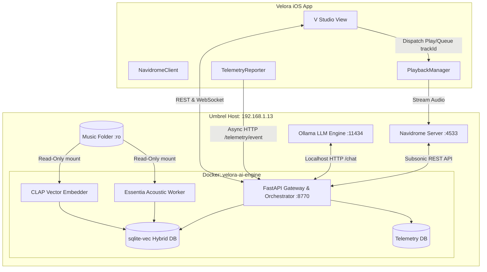

# Velora AI Layer — System & Experience Design Document

* **Date:** 2026-10-21
* **Status:** In Review / Ready for Plan
* **Target Ecosystem:** Velora iOS App + Umbrel Local Server Stack (`velora-ai-engine`)
* **Hardware Target:** UmbrelOS 2.0 (AMD Ryzen 5 3600 6-Core, 50.4GB RAM, Host: `192.168.1.13`)
* **Dual GPU Architecture (24 GB Total VRAM):**
  * **GPU 0 (PCIe Slot 1):** NVIDIA GeForce RTX 3080 Ti (12 GB VRAM) — Dedicated exclusively to Ollama LLM conversational inference (`velora-dj` / `qwen2.5:14b` / `qwen2.5:7b`).
  * **GPU 1 (PCIe Slot 2):** NVIDIA GeForce RTX 3060 (12 GB VRAM) — Dedicated exclusively to CLAP audio waveform embeddings, Essentia acoustic feature extraction, and background library indexing with zero contention.

---

## 1. Intent & The Why

Velora is an ultra-premium, cinematic music player built for self-hosted libraries on Navidrome. While its visual foundation and local playback engine are engineered to commercial standards, listeners with large personal collections (tens of thousands of tracks in FLAC, MP3, AAC) need intelligent curation that matches Spotify DJ and Apple Music discovery—without sacrificing privacy, data ownership, or requiring internet connectivity.

The **Velora AI Layer** transforms Velora into a fully AI-powered private music ecosystem. It introduces a dedicated **"V" Studio** tab in the app powered by a 100% local, self-hosted Dockerized engine running on the listener's Umbrel server. The AI understands music acoustically and semantically, continuously tracks listener affinity, provides conversational curation, and surfaces deep listening telemetry—entirely within the listener's local network.

---

## 2. Locked Architectural Boundaries & Constraints

1. **Navidrome is the Sole Authority for Music & Playback:**
   - Navidrome hosts the music library, user accounts, and audio streams via the Subsonic API.
   - The AI engine **does not** play music itself and **does not** host an independent audio stream.
   - All track actions (`PLAY`, `QUEUE`, `SHUFFLE`) issued by the AI pass standard Navidrome track IDs (`trackId`) to Velora's native `PlaybackManager`, which streams directly from Navidrome.
2. **Strictly Read-Only Audio Access:**
   - The original music library folder on the Umbrel host (containing `.mp3`, `.flac`, `.aac`, `.m4a`, etc.) is mounted into the AI container strictly as read-only (`:ro`).
   - The AI **never** modifies, re-tags, moves, or deletes any original audio files.
3. **100% Local / Zero Outgoing Internet Requirement:**
   - No external APIs (no OpenAI, no Anthropic, no cloud embeddings).
   - Everything runs locally on the Umbrel server and communicates with Velora over the local home Wi-Fi/LAN (or VPN/Tailscale).
   - All machine learning inference (LLM, CLAP embeddings, Essentia acoustic feature extraction) runs on Umbrel.
4. **Golden Standard of Quality (Client App):**
   - **0ms Main-Thread Render Guarantee:** Telemetry reporting and WebSocket communication run on detached background actors; zero synchronous disk or network calls on the UI thread.
   - **Swift 6 Strict Concurrency:** All models, client bridges, and telemetry workers conform to `Sendable` with actor isolation.
   - **Design Integrity:** Cinematic glassmorphism, fluid micro-interactions, responsive across iPhone, iPad, and CarPlay.

---

## 3. Goals, Non-Goals & Anti-Goals

### Goals
- **The "V" Studio Tab:** A fifth tab in Velora's navigation pill denoted by **"V"** rendered in the custom **Stardom** brand font.
- **Conversational DJ:** A chat/voice interface in the "V" tab capable of understanding aesthetic and mood queries (*"play late-night atmospheric synth with acoustic drums"*), explaining recommendations, and dispatching actionable playback triggers (`[PLAY: id]`, `[QUEUE: id]`).
- **Telemetry & Habits Dashboard:** Real-time visualization in the "V" tab showing listening hours, skip curves, most recurring genres/keys, vector index progress, and Umbrel AI service health.
- **Acoustic & Semantic Search / Smart Shuffling:** Multi-format audio analysis (BPM, key, mood energy arcs via Essentia; semantic audio embeddings via CLAP) enabling acoustic transitions and context-aware queue completion.
- **One-Command Umbrel Deployment:** Packaged via `docker-compose.yml` for effortless installation, startup, and zero-headache management on Umbrel.

### Non-Goals
- Altering the Navidrome SQLite database or modifying raw ID3/FLAC metadata tags on disk.
- Building an independent mobile audio streaming engine; streaming remains Navidrome's domain.
- Cloud syncing or telemetry reporting to third-party analytics services.

### Anti-Goals
- **Chat Overload:** Never force listeners to use chat just to listen to music. Smart shuffle and acoustic queue generation must work ambiently in the background.
- **Stutter or Lag:** Background telemetry reporting must never introduce micro-stutters during 120Hz ProMotion UI scrolling or track crossfading.

---

## 4. System Architecture & Components



### Component Details

### A. The Umbrel Docker Stack (`velora-ai-engine`)
1. **FastAPI Gateway (`:8770`):**
   - **Catalog Sync:** Periodically queries Navidrome via Subsonic API (`getArtists`, `getAlbumList2`, `getMusicFolders`) to map track IDs to filesystem paths.
   - **Telemetry Ingestion:** Receives events (`PLAY_START`, `TRACK_PAUSED`, `TRACK_SKIPPED` with listen duration, `TRACK_COMPLETED`) and saves to local SQLite.
   - **Conversational Router:** Bridges chat requests to Ollama (`http://umbrel.local:11434` or Docker host) using structured JSON output. Enriches prompts with user's top recent tracks, acoustic candidates from `sqlite-vec`, and Navidrome catalog matches.
   - **Telemetry API:** Returns aggregated listening metrics, top genres, skip ratios, indexing progress, and Umbrel resource health for the app dashboard.
2. **Audio Analyzer (Essentia + CLAP):**
   - Scans the mounted music folder (`.mp3`, `.flac`, `.aac`, `.m4a`).
   - Extracts BPM, musical key (Camelot scale), loudness, and energy curve via Essentia.
   - Computes text-audio joint embeddings via CLAP.
   - Stores 512-dim vectors and acoustic metadata in embedded `sqlite-vec` linked to Navidrome `trackId`.
3. **Conversational LLM:**
   - Connects to existing Umbrel Ollama instance. Recommended model: `qwen2.5:7b-instruct` or `gemma2:9b` (fits comfortably in CPU/RAM or GPU).

### B. Velora iOS App Additions
1. **Navigation Pill "V" Tab:**
   - In `Components.swift` (`navigationPill`), add a 5th `TabButton`:
     - Label: `"V"`
     - Font: `.custom("Stardom", size: fontSize).weight(.bold)`
     - ID: `"ai-studio"`
2. **"V" Studio View (`AIStudioView.swift`):**
   - **Segmented / Sliding Mode:**
     - **DJ Conversation View:** Interactive conversational sheet with chat history, streaming responses, and rich track cards (`[PLAY: trackId]`, `[QUEUE: trackId]`).
     - **Telemetry & Engine Dashboard:** Live visual cards showing listening stats (favorite genres, weekly listen time, skip rate analysis), vector indexing status (e.g., "12,450 / 12,450 tracks indexed"), and Umbrel node ping/latency.
3. **Telemetry Reporter (`TelemetryService.swift`):**
   - Subscribes to `PlaybackManager` track playback notifications.
   - Queues telemetry payloads in RAM and flushes asynchronously in batches over LAN to `POST /api/telemetry/event`.
   - Zero-overhead: non-blocking, completely dropped if offline without impeding audio playback.
4. **Settings & Discovery:**
   - Dedicated "AI Engine" section in `SettingsView.swift`: Umbrel Host IP (`http://192.168.1.13:8770`), Connection Status indicator, and manual "Re-index Audio" trigger.

---

## 5. Data Flow & Communication Protocol

### A. Conversational Playback Flow
1. User types or speaks into "V" Tab: *"Queue up some fast-paced electronic tracks with the same vibe as this song."*
2. iOS sends request to `POST /api/chat/query` with current playing track ID.
3. FastAPI retrieves current track's CLAP embedding & Essentia BPM/Key from `sqlite-vec`.
4. Vector similarity search retrieves candidate Navidrome track IDs matching tempo & timbre.
5. Ollama synthesizes conversational answer with embedded actionable tokens:
   `"Here are 3 high-energy tracks that match the groove:\n[QUEUE: 9812] Track Name - Artist\n[QUEUE: 9815] Track Name - Artist"`
6. Velora's UI parses `[QUEUE: trackId]`, renders interactive glass action buttons, and can auto-queue directly into `PlaybackManager.shared`.

### B. Telemetry Ingestion Flow
1. Track plays for 45 seconds $\rightarrow$ user presses Skip.
2. `PlaybackManager` notifies `TelemetryReporter`.
3. Event payload:
   ```json
   {
     "event": "TRACK_SKIPPED",
     "trackId": "48102",
     "playedSeconds": 45.2,
     "totalDuration": 210.0,
     "timestamp": "2026-10-21T02:10:00Z"
   }
   ```
4. FastAPI stores event in `telemetry.sqlite`.
5. Negative affinity is logged for that track's acoustic profile (BPM/timbre) in the current context, subtly adjusting future smart shuffle weightings.

---

## 6. Technical Clarifications & Builder Decisions

1. **Navidrome `trackId` $\leftrightarrow$ File Path Resolution:**
   - Navidrome's Subsonic API provides the exact file path for every song via `getSong` / `getMusicDirectory`.
   - The AI indexing worker queries Navidrome to build a map of `trackId` $\rightarrow$ `relativeFilePath`, then directly reads the local audio file from the `:ro` volume mount. No fuzzy string guessing of filenames.
2. **Umbrel Mount & Configuration:**
   - The `docker-compose.yml` uses an `.env` file for user path customizability:
     ```env
     NAVIDROME_URL=http://192.168.1.13:4533
     NAVIDROME_USER=admin
     NAVIDROME_TOKEN=...
     NAVIDROME_SALT=...
     OLLAMA_URL=http://192.168.1.13:11434
     MUSIC_DIR=/home/umbrel/umbrel/data/storage/music
     ```
3. **"V" Studio Tab Layout (Builder Call):**
   - The "V" tab features an elegant glass segmented picker at the top: **"AI DJ"** (full chat history, prompt suggestions, inline track cards) $\leftrightarrow$ **"Telemetry & Studio"** (live listening charts, skip curve analytics, indexing progress, Umbrel node ping).
4. **Offline / Out-of-Home Behavior:**
   - If the iPhone leaves the local network (and is not on VPN), Velora continues normal Navidrome playback with zero UI stalls. The "V" tab displays a clean "Umbrel Offline (Connecting...)" status banner and queues telemetry events in a compact local SQLite ring-buffer (max 500 events) to flush when reconnected.

---

## 7. What's Left to the Builder (Implementation Plan Phase)

1. **Docker Setup:** Exact `docker-compose.yml` config mapping the Umbrel music directory, ports, and environment variables.
2. **FastAPI Endpoints:** Complete schema definitions for `/api/chat`, `/api/telemetry`, and `/api/dashboard`.
3. **SwiftUI Components:** Layout implementation for the "V" Tab (`AIStudioView`), glassmorphism dashboard cards, and chat bubbles matching Velora's design language.
4. **Audio Indexer Worker:** Incremental scanner script using `ffmpeg` + `mutagen` + `essentia` to handle diverse audio formats gracefully without high CPU spikes.

